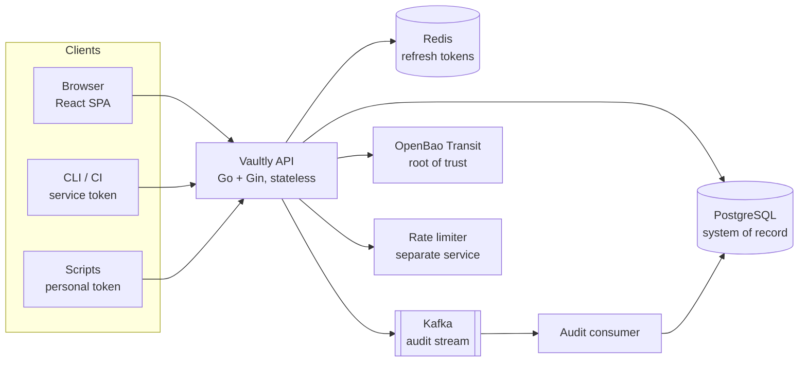
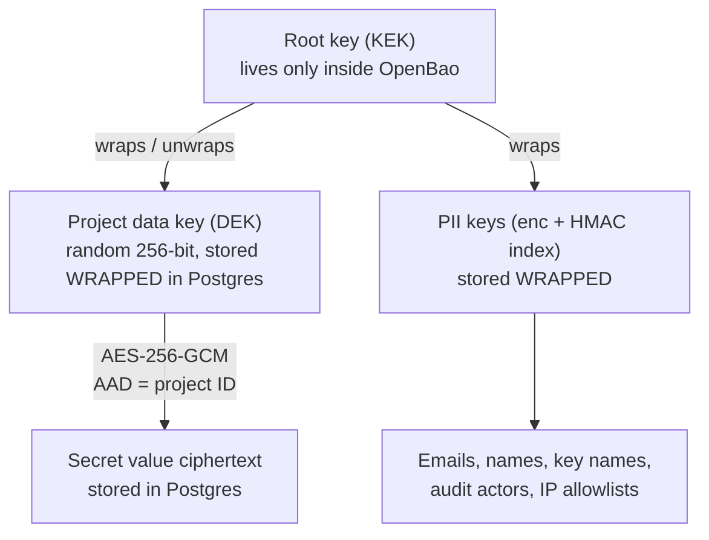
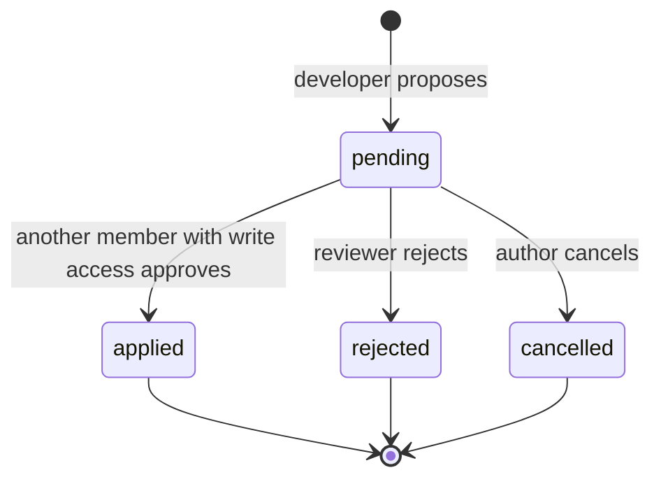

# Vaultly design

This page explains how Vaultly is built and why, and what an attacker can and can't do at each layer.
The longer notes in `docs/*.txt` go deeper on each topic.

## 1. Shape of the system

Vaultly is a **modular monolith**: one stateless Go API with strict layers inside
(`handler → service → repository`), a React app in front, and a few infrastructure services around it.



| Store | Holds | Why this one |
|---|---|---|
| PostgreSQL | Everything durable: secrets (ciphertext), versions, members, audit log | Transactions (`SELECT … FOR UPDATE` for versioning), one consistent source of truth |
| Redis | Refresh tokens, fallback rate-limit counters | Fast, disposable, atomic (`GETDEL`, Lua) |
| Kafka | Audit events in transit | Takes audit writes off the request path; keyed by workspace so each workspace's events stay ordered; replayable |
| OpenBao | The root key (Transit engine) | The root key never leaves it; Vaultly only asks it to wrap and unwrap data keys |

**Why a monolith?** You get one deployable and one transaction boundary. There are no network hops
between domains, and `make up` runs everything. Each domain package (`internal/secret`, `internal/token`,
and so on) only talks to the others through interfaces, so any one of them could be pulled out later.
The rate limiter already was, for the reason in section 6.

## 2. Encryption: envelope encryption with a key per project



**Reading a secret:**
1. Load the wrapped data key for the project.
2. Ask OpenBao to unwrap it. The result is cached in memory for about 60 seconds.
3. Decrypt the value with AES-256-GCM, passing the project ID as additional data (AAD).

**Why envelope encryption, not "send every value to OpenBao"?**
- **Speed and availability.** A request makes one unwrap call at most, not one call per secret. Exporting
  200 secrets is a single round-trip to OpenBao.
- **Key rotation is cheap.** Rotating the root key only rewraps the small data keys (`server rewrap`).
  The secrets themselves are never re-encrypted.
- **Blast radius.** Each project has its own data key. Because the project ID is bound in as AAD, ciphertext
  copied into another project's row fails to decrypt, rather than decrypting under the wrong project.
  A test covers this (`TestResolveProjectBoundAAD`).
- **Choice of backend.** `crypto.KeyProvider` has two implementations: OpenBao, and a local `MASTER_KEY`.
  The rest of the code doesn't know which one is in use.

**Personal data is encrypted too.** Emails, names, secret key names, comments, IP allowlists and audit
actors are sealed with a separate key pair. Login still works because of an HMAC "blind index": equal emails
give equal hashes, so a user can be looked up without the email being stored in clear. Labels that a team
browses, such as project and environment names, stay readable on purpose (see `docs/13_*`).

## 3. Threat model

| An attacker gets… | They can | They can't |
|---|---|---|
| **A database dump** | See how a team is organised: project and environment names, row counts, timestamps | Read secret values, secret names, emails or IP allowlists. Everything sensitive is ciphertext, and the keys that would open it are wrapped. |
| **Redis** | See rate-limit counters | Use refresh tokens: only their SHA-256 hashes are stored |
| **Kafka** | See that events happened | Read actors, resources or IPs, which are sealed before publishing |
| **OpenBao alone** | Unwrap data keys, if they also had the wrapped keys | Do anything without the database: OpenBao holds no data |
| **Database + OpenBao** | Everything. **This is the root of trust**: protect OpenBao's token and unseal key like a root password. | — |
| **The running API process** | Everything it can serve. It holds unwrapped keys while running. | — (Vaultly is not end-to-end encrypted, by design) |
| **A leaked service token** | Read, and write only if the token allows writing, within **one environment and one path prefix** | Reach other paths, even through `${…}` references; manage anything; use it from outside its IP allowlist (denials are audited) |
| **A leaked personal token** | Act as that user, with the same roles | Mint or revoke tokens: that needs a password session |
| **A stolen backup file** | Nothing, without the passphrase | It is sealed with scrypt + AES-256-GCM |

**Authorization rules worth knowing:**
- **Roles.** Workspace roles are admin, developer and viewer. A per-environment override (none, viewer or
  developer) **wins for that environment**, so a developer can be made view-only on `prod`. Admins ignore
  overrides.
- **Non-members get 404, not 403**, so a probe can't confirm that a project exists.
- **References** (`${KEY}`, `${/path/KEY}`, `${env:/path/KEY}`) resolve with the caller's scope:
  - Every hop is checked, so a secret the caller can read can't point them to one they can't.
  - A reference that loops back on itself stops where the loop closes.
  - A reference chain stops after a depth of 8.

These rules are all covered by tests in `internal/access` and `internal/secret`.

## 4. Sessions: short access tokens, refresh tokens that rotate on every use

```mermaid
sequenceDiagram
  participant B as Browser
  participant A as API
  participant R as Redis
  B->>A: POST /auth/login (email, password)
  Note over B,A: with 2FA on, login returns a challenge first;<br/>POST /auth/login/mfa (challenge, code) continues here
  A->>R: SET rt:sha256(token) = user  (7 days)
  A-->>B: access JWT (15 min, kept in memory) + refresh cookie (httpOnly, SameSite=Strict, path=/api/auth)
  Note over B: …15 minutes later…
  B->>A: POST /auth/refresh (cookie)
  A->>R: GETDEL rt:sha256(old)   ← atomic: one use only
  A->>R: SET rt:sha256(new)
  A-->>B: new access JWT + new refresh cookie
```

**Why rotate the refresh token on every use?**
- A refresh token lasts 7 days, so it is the valuable one to steal. Making each token single-use (with an
  atomic `GETDEL`) means a stolen copy works at most once. The moment either party uses it, the other's copy
  is dead.
- Storing only the hash means a Redis dump yields no usable tokens.
- The access token is a short-lived (15-minute) JWT kept only in memory, so XSS can't read it from storage.
  The refresh cookie is `httpOnly` and scoped to `/api/auth`, so it is never sent anywhere else.

**Trade-off and next step.** Today, when a stolen refresh token is used first, the real user just gets
logged out. Best practice is *reuse detection*: tokens belong to a family, and presenting a token that was
already used revokes the whole family. That needs a token-family ID in Redis. I have deliberately left it out.

## 5. Two-factor sign-in

TOTP (RFC 6238) is optional per user, with 10 single-use recovery codes.
- **Storing the TOTP secret.** It is sealed with the PII key, so a database dump doesn't reveal it.
  Recovery codes are stored as SHA-256 hashes, like tokens.
- **Login.** When 2FA is on, the password step returns a short-lived, single-use *challenge* instead of
  a session. The client sends that challenge back with a code. There is no session until both steps pass.
- **Stopping replay.** The last accepted time step is stored, and any code from that step or earlier is
  rejected, so a code someone shoulder-surfed can't be reused within its 30-second window.
- **Limiting attempts.** The code endpoint has its own strict rate limit, and a challenge dies after
  5 wrong codes.
- **Turning it off** needs the password *and* a current code, so a stolen session alone can't remove it.
  Personal access tokens can't change 2FA settings at all.

## 6. Rate limiting as a separate service

Every route is rate-limited with a sliding window, with stricter limits on login, register, reveal and
export. Decisions come from a **standalone rate-limiter service** with its own database. The API
falls back to an in-process limiter backed by Redis and Lua if that service is unreachable.

**Why a separate service?**
- **It is genuinely independent.** It has its own policies, algorithms and clients. Nothing about it is
  specific to Vaultly.
- **One decision across replicas.** The API is stateless, so with several replicas the limit must live
  outside the process. Otherwise each replica would allow the full limit.
- **Failure isolation.** If the limiter is slow or down, the API falls back to the local limiter after a
  2-second timeout instead of failing the request.

**Trade-off.** It adds a network hop to every request. The fallback also means limits fail open
(a looser local limit) rather than closed. I accepted that for availability, but for login it's a
judgement call.

## 7. Audit trail

- Every sensitive action emits an event. That includes reveals, exports, token use, denials, role
  changes and integration syncs.
- Events go to Kafka, keyed by workspace so each workspace's events stay in order. A consumer writes them to
  Postgres, and the insert is idempotent (`ON CONFLICT DO NOTHING`), so a redelivered event isn't
  written twice.
- **If Kafka is down**, the API writes to Postgres directly, so an event is never silently dropped and the
  request never fails because of auditing.
- Actor, resource and IP are sealed before publishing.

## 8. Change approvals on protected environments

An environment can be marked **protected**. On a protected environment, a non-admin's change to a secret
becomes a **change request** instead of a write:



- **Who can do what.** You can't approve your own request. Approving needs developer access to that
  environment or higher.
- **How a change is applied.** Applying runs the normal versioned write path, so the change gets a new
  version, the usual audit event and webhooks, exactly as a direct write would.
- **Storage.** The proposed value is encrypted with the project's data key, like any secret.
- **Stale requests.** If the secret changed after the request was opened, approving fails with a conflict
  instead of silently overwriting the newer value. The version check runs inside the same
  `SELECT … FOR UPDATE` transaction as the write, so there is no gap between checking and writing.
- **Double approval.** Moving a request out of `pending` is a compare-and-set on its status, so two
  reviewers clicking at once can't both apply it. If applying fails, the request goes back to `pending`.
- **One open request per secret**, enforced by a partial unique index, so reviewers never weigh two
  competing proposals for the same key.
- **Admins write directly**, since they can turn protection off anyway. Rotate, restore and `.env` import
  are refused for developers on a protected environment, because each value has to be reviewed.

## 9. Comparing environments

The Compare view lines up environments key by key and flags keys that are **missing** somewhere or have
**different values**. The server decrypts and compares the values, then returns only a group number per
environment: equal values share a number. Values never leave the server, so comparing needs only read
access and doesn't count as revealing anything. It is still audited (`secret.compare`).

## 10. CLI and the offline cache

`vaultly login` stores a service token in `~/.config/vaultly/credentials.json` (mode 0600).
`vaultly setup` writes a `.vaultly.json` holding only the profile name and folder, so it is safe to commit.

**What happens when the server is down?** Every successful fetch is cached on disk, and `pull` and `run`
fall back to that copy, with a warning, when the server can't be reached or returns a 5xx.
- **Encryption.** The copy is encrypted with AES-256-GCM under a key derived (HKDF) from the token.
  The file name is a hash and reveals nothing. A copied cache file is useless without the token, and
  anyone holding the token could fetch the secrets anyway, so the cache grants nothing new.
- **Never for a definite "no".** On 401, 403 or 404 the CLI does not fall back, and it deletes the entry.
  A revoked token must stop working at once, not keep serving stale secrets for a day.
- **A time limit.** Entries older than `--max-age` (default 24h) are ignored. `--no-cache` turns the cache
  off entirely.

## 11. Known limits

These are deliberate: the scope of a portfolio project, not oversights.
- **Not end-to-end encrypted.** The server decrypts values in order to serve them.
- **OpenBao runs as a demo setup.** It is single-node, without TLS, and unseals with one key kept on a volume.
- **Key rotation is manual.** The root key rotates with `server rewrap`. The PII keys can't be rotated yet.
- **Rate limits fail open** if both the limiter service and Redis are down.
- **No SSO, SCIM, password reset or email verification.**
- **Refresh tokens have no reuse detection.** See section 4.

## 12. Where to look in the code

| Concern | Package |
|---|---|
| Permission checks | `internal/access` |
| Encryption, key providers | `internal/crypto`, `internal/keystore`, `internal/pii` |
| Secrets, versions, references | `internal/secret` (`resolver.go`) |
| Service and personal tokens | `internal/token` |
| Sessions, 2FA | `internal/auth` (`totp.go`), `internal/user` (`mfa.go`) |
| Change requests, compare | `internal/secret` (`changes.go`, `compare.go`) |
| CLI, offline cache | `cmd/vaultly` (`cache.go`) |
| Rate limiting | `internal/ratelimit` |
| Audit | `internal/audit` |
